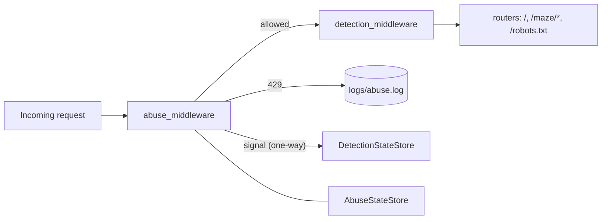
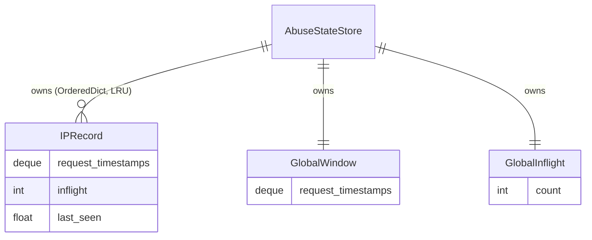
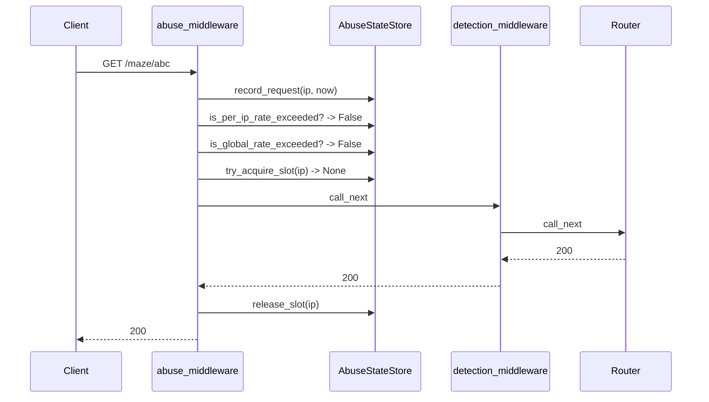
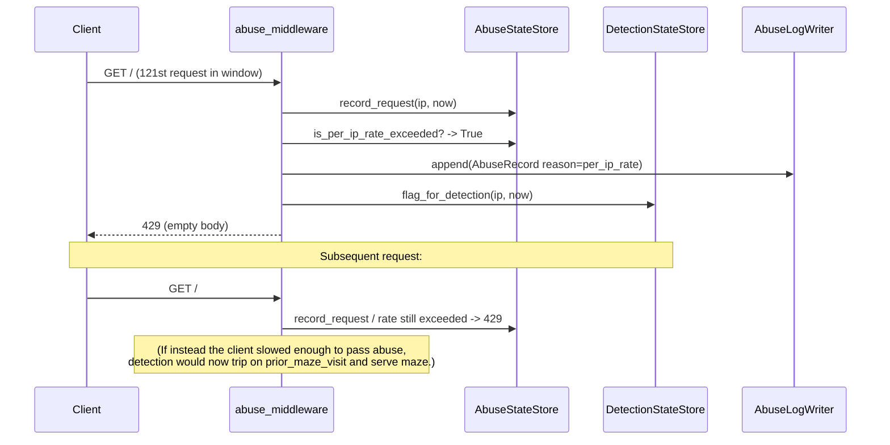
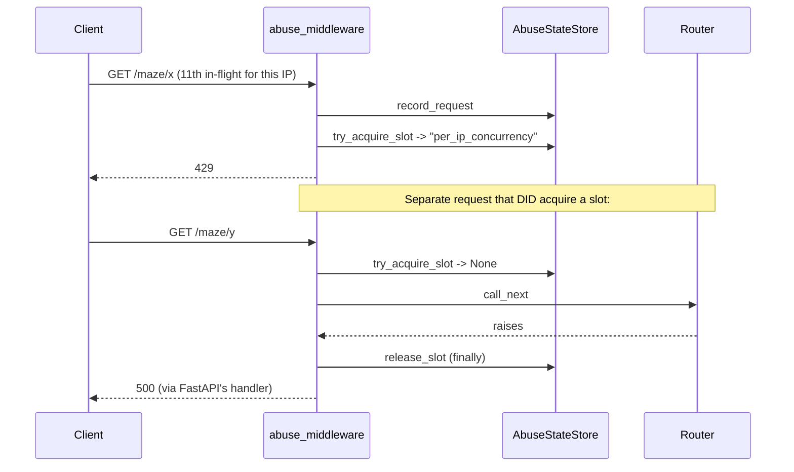

# Abuse Protection (v2.2) — Design

**Status:** Draft · **Date:** 2026-10-23 · **Requirements:** [requirements.md](./requirements.md)

## 1. Architecture overview

- A new `src/tarpit/abuse/` package parallel to `src/tarpit/detection/`. Four modules: `state.py`, `log.py`, `middleware.py`, and `reasons.py` (constants). Mirroring the detection layout keeps the two layers trivially comparable.
- A single `AbuseStateStore` holds all four counter kinds (per-IP sliding window, per-IP in-flight, global in-flight, global sliding window). One store keeps state coherent and makes the kill switch a single toggle.
- One FastAPI HTTP middleware, `abuse_middleware`, registered in `create_app()` **after** `register_detection_middleware(app)`. FastAPI runs middleware in reverse registration order, so this places abuse-protection *first* on the request path, satisfying REQ-SCOPE-03. A regression test asserts the resulting runtime order.
- Signal flow to v2.1 is one line: on a 429, call a new method on `DetectionStateStore` that marks the IP as "already in the maze" for detection purposes. Abuse never reads detection state. Detection never reads abuse state.



## 2. Contracts (frozen)

These shapes do not change without re-opening design.

### 2.1 Settings — additions to `src/tarpit/settings.py`

```python
abuse_protection_enabled: bool = True
abuse_log_path: Path = Path("logs/abuse.log")

rl_per_ip_budget: int = 120
rl_per_ip_window_s: float = 60.0
rl_state_max_entries: int = 10_000

cc_per_ip_max: int = 10

gl_inflight_max: int = 500
gl_rate_budget: int = 1_000
gl_window_s: float = 60.0
```

All consume the existing `TARPIT_` env prefix. Field names map to env vars by uppercasing (e.g. `TARPIT_RL_PER_IP_BUDGET`). No validators beyond the pydantic defaults; CLAUDE.md "trust internal code — validate at boundaries" means operators who set `TARPIT_RL_PER_IP_BUDGET=0` get what they asked for.

### 2.2 Reason constants — `src/tarpit/abuse/reasons.py`

```python
from typing import Final

REASON_PER_IP_RATE: Final[str] = "per_ip_rate"
REASON_PER_IP_CONCURRENCY: Final[str] = "per_ip_concurrency"
REASON_GLOBAL_INFLIGHT: Final[str] = "global_inflight"
REASON_GLOBAL_RATE: Final[str] = "global_rate"
```

These exact string values appear in `logs/abuse.log`. REQ-LOG-02 pins the enumeration.

### 2.3 `AbuseStateStore` — `src/tarpit/abuse/state.py`

Single store. All methods synchronous; safe to call from the asyncio event loop without a lock given `workers=1` and no `await` inside any method.

```python
class AbuseStateStore:
    def __init__(
        self,
        *,
        per_ip_window_s: float,
        per_ip_budget: int,
        per_ip_concurrency_max: int,
        per_ip_state_max_entries: int,
        global_window_s: float,
        global_rate_budget: int,
        global_inflight_max: int,
    ) -> None: ...

    # --- rate (per-IP sliding window) ---
    def record_request(self, ip: str, now: float) -> None:
        """Append `now` to this IP's deque. Prune < now - per_ip_window_s.
        Touch LRU. Evict LRU if size > per_ip_state_max_entries.
        Also append to the global sliding-window deque (same prune rule
        with global_window_s). Counts EVERY call, including requests
        that will later be denied (REQ-RL-05)."""

    def is_per_ip_rate_exceeded(self, ip: str, now: float) -> bool:
        """True iff post-prune count > per_ip_budget. Unknown IP -> False."""

    def is_global_rate_exceeded(self, now: float) -> bool:
        """True iff post-prune global count > global_rate_budget."""

    # --- concurrency ---
    def try_acquire_slot(self, ip: str) -> str | None:
        """Attempt to reserve one per-IP + one global in-flight slot.
        Returns None on success. On failure returns the reason constant
        that blocked (REASON_PER_IP_CONCURRENCY checked first,
        REASON_GLOBAL_INFLIGHT second). On success, both counters are
        incremented atomically from the caller's point of view (no await
        between the two increments)."""

    def release_slot(self, ip: str) -> None:
        """Decrement per-IP + global in-flight. MUST be called exactly
        once per successful try_acquire_slot. Safe to call for an IP
        whose per-IP counter is 0 (clamps at 0, logs nothing)."""

    # --- introspection (tests + /debug) ---
    def per_ip_inflight(self, ip: str) -> int: ...
    def global_inflight(self) -> int: ...
    def __len__(self) -> int: ...  # per-IP table size
```

Internals (not contract, documented for implementors): per-IP record is a dataclass holding `request_timestamps: deque[float]`, `inflight: int`, `last_seen: float`. Table is an `OrderedDict`. Global state is a `deque[float]` + an `int`. No locks.

### 2.4 Log record + writer — `src/tarpit/abuse/log.py`

```python
@dataclass(frozen=True)
class AbuseRecord:
    ts: str          # ISO-8601 UTC with trailing 'Z'
    ip: str          # request.client.host, "unknown" if absent
    ua: str | None   # User-Agent header, None if absent
    path: str        # request.url.path, no query string
    reason: str      # one of the REASON_* constants

class AbuseLogWriter:
    def __init__(self, file: TextIO, lock: asyncio.Lock) -> None: ...
    async def append(self, record: AbuseRecord) -> None:
        """One JSON line, newline-terminated. Key order:
        ts, ip, ua, path, reason. Flush under lock via asyncio.to_thread."""
```

Mirrors `DetectionLogWriter` exactly — same disk discipline (append-only, flush-per-write, async lock, blocking IO off-loop).

### 2.5 Middleware — `src/tarpit/abuse/middleware.py`

```python
def register_abuse_middleware(app: FastAPI) -> None: ...
```

Runtime behaviour (per request):

1. If `settings.abuse_protection_enabled` is `False` → `return await call_next(request)`. No state read, no state mutation, no log write (REQ-SWITCH-01).
2. If `request.url.path == "/robots.txt"` → pass through unchecked (REQ-GL-04, REQ-SCOPE-02).
3. If `request.url.path` is not `/` and does not start with `/maze/` → pass through unchecked. (Guards against accidentally limiting future diagnostic routes; the requirement enumerates the scoped paths explicitly.)
4. Extract `ip = request.client.host if request.client else "unknown"`.
5. `now = time.monotonic()`.
6. `store.record_request(ip, now)` — unconditional, before any check (REQ-RL-05).
7. Evaluate limits in a fixed order and short-circuit on the first breach:
   1. `is_per_ip_rate_exceeded(ip, now)` → `REASON_PER_IP_RATE`
   2. `is_global_rate_exceeded(now)` → `REASON_GLOBAL_RATE`
   3. `try_acquire_slot(ip)` returns a reason → that reason
8. On any breach: write `AbuseRecord`, call `_signal_detection(ip)` (see 2.6), return `Response(status_code=429, content=b"", media_type="text/plain")`. **No** `Retry-After` (REQ-RESP-02). No body (REQ-RESP-03).
9. On no breach: wrap `call_next` in `try/finally`; `finally` calls `store.release_slot(ip)`. This guarantees decrement on every exit path (REQ-CC-03).

Evaluation order rationale: rate checks are O(1) reads; concurrency check is the only one that mutates and requires rollback on exception, so it's checked last.

### 2.6 Signal to detection — new method on `DetectionStateStore`

Add one method to `src/tarpit/detection/state.py`:

```python
def flag_for_detection(self, ip: str, now: float) -> None:
    """Called by abuse protection on 429. Ensures a record exists for
    `ip` (creates if needed, touches LRU, applies the same eviction rule
    as record_request) and sets has_visited_maze = True so the next
    request from this IP trips the prior_maze_visit signal in
    detection.signals.evaluate_request."""
```

This is a strict extension of the existing API; it does not modify `rate_exceeded` (which the requirements explicitly forbid modifying — REQ non-goal). Abuse middleware calls `request.app.state.detection_store.flag_for_detection(ip, now)` immediately before returning 429, **unless** `settings.detection_enabled` is `False`, in which case the call is skipped (REQ-SIG-04). Abuse never reads detection state (REQ-SIG-02).

### 2.7 Response shape

- Status: `429`
- Body: empty bytes
- `Content-Type: text/plain; charset=utf-8`
- `Content-Length: 0`
- No `Retry-After`, no custom headers naming the reason, no JSON

### 2.8 Lifespan wiring — `src/tarpit/main.py`

Inside `lifespan`:

```python
app.state.abuse_store = AbuseStateStore(
    per_ip_window_s=settings.rl_per_ip_window_s,
    per_ip_budget=settings.rl_per_ip_budget,
    per_ip_concurrency_max=settings.cc_per_ip_max,
    per_ip_state_max_entries=settings.rl_state_max_entries,
    global_window_s=settings.gl_window_s,
    global_rate_budget=settings.gl_rate_budget,
    global_inflight_max=settings.gl_inflight_max,
)
settings.abuse_log_path.parent.mkdir(parents=True, exist_ok=True)
abuse_file = settings.abuse_log_path.open("a", encoding="utf-8")
app.state.abuse_log_writer = AbuseLogWriter(abuse_file, asyncio.Lock())
```

Close `abuse_file` in the shutdown half.

In `create_app()`, after routers are included:

```python
register_detection_middleware(app)   # registered first → runs second
register_abuse_middleware(app)       # registered second → runs first
```

## 3. Data model



Lifecycle:
- `IPRecord` is created on first `record_request(ip, …)`, touched (moved to end) on every subsequent call, and evicted when the per-IP table exceeds `rl_state_max_entries`. There is no explicit TTL; LRU + sliding-window prune are the sole eviction mechanisms. An evicted record's `inflight` count may be non-zero if the client has an in-flight request at eviction time — this is a known race (see §6).
- Global counters live for the lifetime of the process.

## 4. Key flows

### 4.1 Request under limits (happy path)



### 4.2 Per-IP rate breach + signal to detection



### 4.3 Per-IP concurrency breach with exception during request



## 5. Decisions

- **Decision — single `AbuseStateStore` class, not four small ones.**
  *Alternatives considered:* per-concern classes (`PerIPRateLimiter`, `ConcurrencyLimiter`, …).
  *Why:* The middleware calls them in one sequence and the kill switch disables them together. Splitting adds four injection points to `app.state` and four fixtures in tests for zero decoupling benefit. CLAUDE.md "don't abstract until you have three concrete uses."

- **Decision — add `flag_for_detection(ip, now)` to `DetectionStateStore` rather than reusing `mark_maze_visit`.**
  *Alternatives considered:* (a) have abuse call `mark_maze_visit(ip)` directly; (b) add a new detection signal `prior_abuse_429`.
  *Why:* (a) requires abuse to also call `record_request` to ensure the record exists — leaking detection internals. (b) modifies detection's signal set, which the requirements' non-goals explicitly scope out. A dedicated method is a thin, named extension that keeps the coupling one-directional and testable.

- **Decision — register abuse middleware after detection in `create_app()`.**
  *Alternatives considered:* registering first; reordering detection to register last.
  *Why:* FastAPI runs middleware in reverse registration order. Registering abuse second puts it first on the request path (REQ-SCOPE-03). A test in `tests/test_abuse_middleware_ordering.py` locks this in by sending a request that would 429 and asserting the detection log is empty (detection never saw it).

- **Decision — `record_request` is called before the rate check and counts every request including those about to be 429'd (REQ-RL-05).**
  *Alternatives considered:* "free" denials to avoid self-reinforcing lockout.
  *Why:* A client stuck at the limit retrying every 50ms would otherwise stay exactly at the budget forever and never trip escalation. Counting denials preserves the sliding-window invariant and keeps `logs/abuse.log` honest.

- **Decision — no locks in `AbuseStateStore`.**
  *Alternatives considered:* `asyncio.Lock` around each mutating method.
  *Why:* `workers=1` is a hard constraint (REQ constraint). All store methods are synchronous and contain no `await`, so under a single-threaded event loop they are atomic by construction. A lock would add overhead and imply a concurrency model the constraints forbid.

- **Decision — rate checks evaluated before concurrency check.**
  *Alternatives considered:* concurrency first.
  *Why:* `try_acquire_slot` mutates (increments both counters). If we checked it first and then found a rate breach, we would have to roll back the slot acquire. Checking the pure-read predicates first avoids the rollback branch entirely.

## 6. Risks & edge cases

- **In-flight race on LRU eviction.** If an IP's record is evicted (per-IP table exceeds `rl_state_max_entries`) while a request from that IP is in flight, `release_slot(ip)` will find no record. The design clamps per-IP decrement at 0 and still decrements the global counter via a slot-token side-channel: `try_acquire_slot` returns `None` on success and the middleware passes `ip` back to `release_slot`, which decrements global unconditionally and per-IP only if the record exists. **Implementor must verify this with a direct test** that forces eviction mid-request.
- **Clock source.** `time.monotonic()` is used throughout — same as v2.1 — so wall-clock jumps do not corrupt windows. Not `time.time()`.
- **Signal flow during detection kill-switch flap.** Operator toggles `TARPIT_DETECTION_ENABLED=false`, abuse 429s continue, operator toggles back to `true`. Previously-429'd IPs will NOT have been flagged (REQ-SIG-04). This is the specified behaviour; design calls it out so no implementor "fixes" it.
- **Default `gl_rate_budget=1000` + default `gl_window_s=60.0` ≈ 16 req/s global.** A single enthusiastic human user refreshing an HTML page that fans out to many `/maze/*` fetches could trip this. Mitigation: `GET /robots.txt` is scope-excluded (REQ-GL-04), but static sub-resources served from `/maze/*` are *not*. Operators observing legitimate traffic 429'd should raise `TARPIT_GL_RATE_BUDGET`. Flagged in README per Q-RESOLVED-7.
- **Reverse-proxy flattening (Q-OPEN-1).** Behind a proxy without trusted-header parsing, every per-IP cap effectively becomes a global cap. Design does not fix this; the public-deployment spec (v2 item #1) must land first. Noted here, in README, and in the settings help text.
- **Abuse log unbounded growth.** REQ-LOG-03 forbids rotation in v2.2. Disk-exhaustion risk is accepted. Future `logs/*` rotation is a separate spec.
- **Rollback plan.** Flip `TARPIT_ABUSE_PROTECTION_ENABLED=false` and restart the process. State is in-memory, so the middleware becomes a pass-through on next request. No DB migrations to reverse.

## 7. Out of scope for this design

- Trusted-header IP extraction (`X-Forwarded-For`) — v2 item #1.
- Shared cross-worker state — v3.
- Metrics endpoint, Prometheus, dashboards — future.
- Per-request CPU-time caps, response-size caps, maze-delay token-bucket shaping — distinct features.
- Blocklisting / sticky bans / cool-downs — explicitly out of scope per requirements non-goals.
- Rotation of `logs/abuse.log` — separate logging spec.
- Tuning the eight default thresholds for a non-local-only deployment — Q-OPEN-1, deferred.
