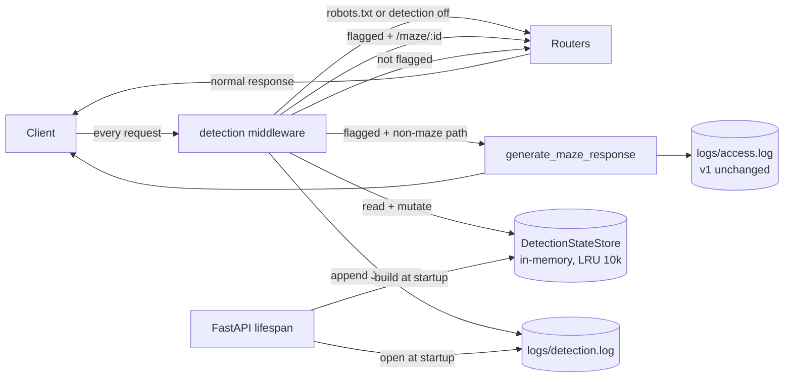
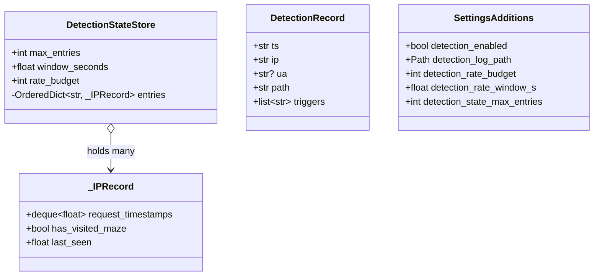
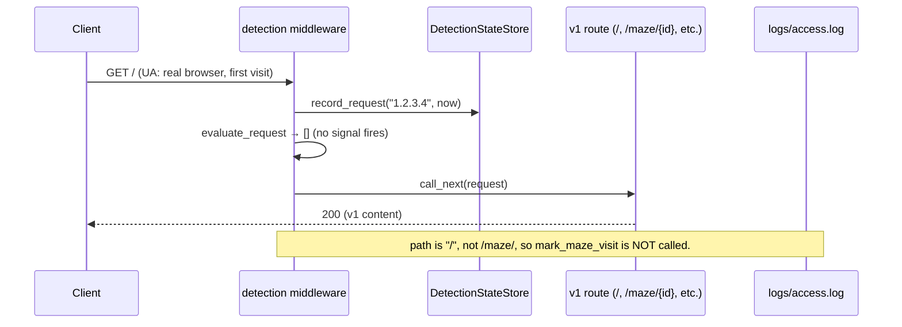
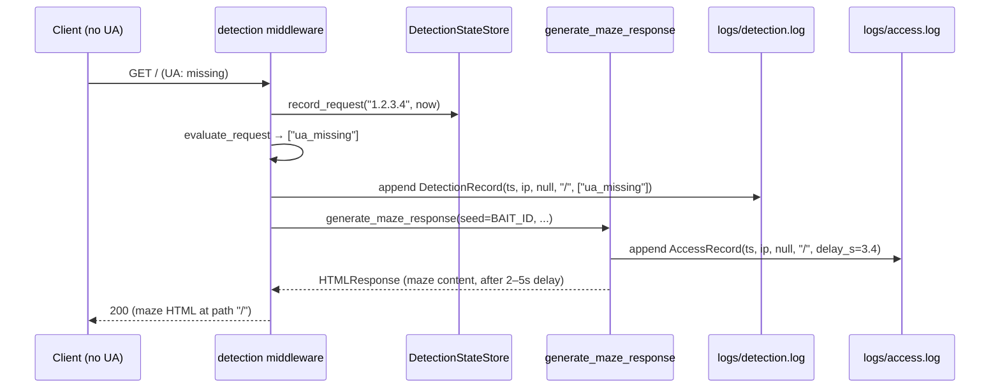
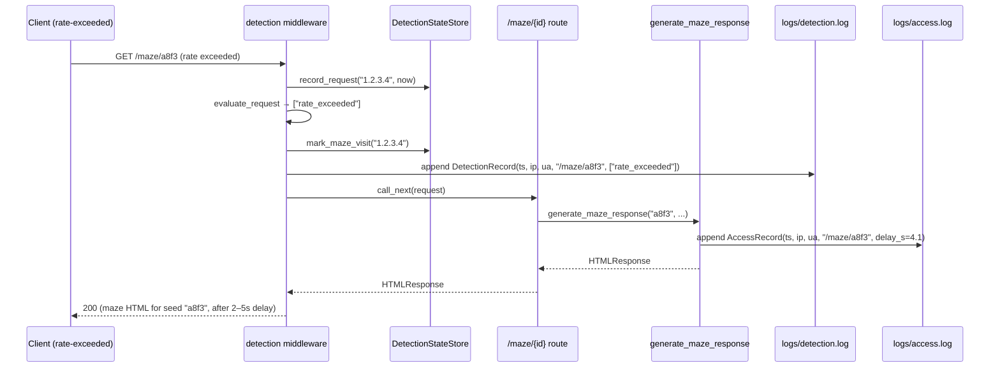
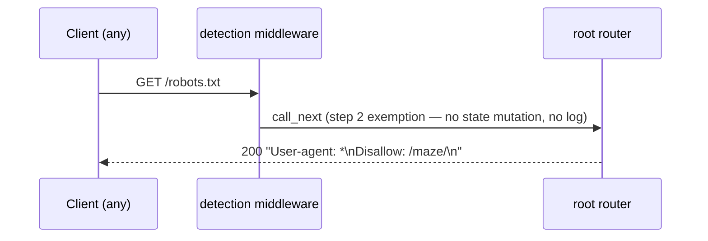
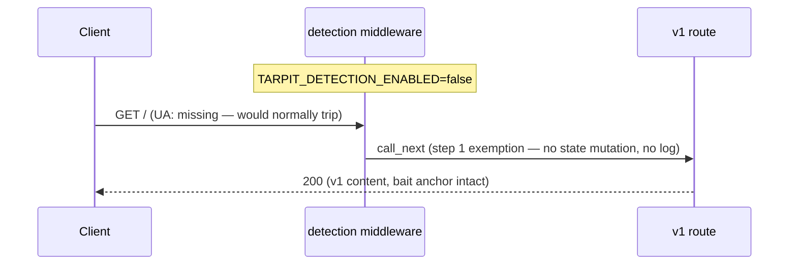

# Bot Detection (v2.1) — Design

**Status:** Draft · **Date:** 2026-10-21 · **Requirements:** [requirements.md](./requirements.md)

## 1. Architecture overview

- Add a FastAPI HTTP middleware that runs for every request, exempts `GET /robots.txt`, mutates in-process per-IP state, evaluates OR-composed hard rules, and either serves maze content inline (via a helper shared with the v1 maze handler) or forwards to the normal route pipeline.
- No new dependencies, no new persistent storage. State is an `OrderedDict`-backed LRU, bounded to 10k entries, discarded on process restart (REQ-STATE-01/02). Single uvicorn worker remains a hard constraint — the state is not shared across workers.
- Detection emits one JSON-lines log (`logs/detection.log`) only when a request is routed into the maze; the v1 `logs/access.log` is untouched by this feature (REQ-INTEG-03).
- Integration into v1 is additive on every file except `routers/maze.py`, which gets a pure internal refactor to extract `generate_maze_response(...)` — same v1 route behaviour, now callable from the middleware too.



## 2. Contracts (frozen)

Once approved, the shapes below do not change without re-opening design.

### 2.1 Middleware contract

Function registered via `app.middleware("http")` in `create_app()`. Reads singletons from `request.app.state`.

Order of operations for every HTTP request:

1. If `settings.detection_enabled` is `False` → `return await call_next(request)` with **no state mutation, no log write**. (REQ-SWITCH-01, REQ-SWITCH-02.)
2. If `request.url.path == "/robots.txt"` → `return await call_next(request)` with **no state mutation, no log write**. (REQ-DET-01 exemption, REQ-RESP-04.)
3. `ip = request.client.host or "unknown"` (REQ-STATE-04).
4. `now = time.monotonic()`.
5. `app.state.detection_store.record_request(ip, now)` — mutates sliding-window counter and LRU order.
6. `triggers = evaluate_request(request, app.state.detection_store, now)` — pure read.
7. If `request.url.path.startswith("/maze/")`: `app.state.detection_store.mark_maze_visit(ip)` — runs **after** step 6 so the current request does not trip `prior_maze_visit` for itself.
8. If `triggers` is non-empty:
   - Build `DetectionRecord` and `await app.state.detection_log_writer.append(record)`.
   - If `request.url.path` matches `^/maze/[A-Za-z0-9._~-]{1,64}$`: `return await call_next(request)` — the v1 maze route handles delay + access log. (REQ-RESP-03.)
   - Else: `return await generate_maze_response(seed=BAIT_ID, request=request, ...)` — middleware produces the response itself using the shared helper. (REQ-RESP-01, REQ-RESP-02, REQ-RESP-05.)
9. Else (not flagged): `return await call_next(request)`.

### 2.2 Internal module interfaces

#### `src/tarpit/detection/state.py`

```python
import time
from collections import OrderedDict, deque
from dataclasses import dataclass, field


@dataclass
class _IPRecord:
    request_timestamps: deque[float] = field(default_factory=deque)
    has_visited_maze: bool = False
    last_seen: float = 0.0


class DetectionStateStore:
    """In-memory per-IP state. Single-process. LRU-bounded.

    All methods are synchronous and non-blocking; safe to call from an
    async event loop without a lock (single uvicorn worker enforced by v1)."""

    def __init__(self, max_entries: int, window_seconds: float, rate_budget: int) -> None: ...

    def record_request(self, ip: str, now: float) -> None:
        """Append `now` to the IP's sliding-window deque; prune timestamps
        older than `now - window_seconds`; mark the IP as most-recently-used
        in the LRU; if the table size exceeds `max_entries`, evict the
        least-recently-used entry (NOT this one). Creates the IPRecord if
        the IP is new."""

    def is_rate_exceeded(self, ip: str, now: float) -> bool:
        """True iff the IP's current sliding-window count (post-prune) is
        strictly greater than `rate_budget`. Returns False for unknown IPs."""

    def has_prior_maze_visit(self, ip: str) -> bool:
        """True iff `mark_maze_visit(ip)` was called earlier. False for
        unknown IPs."""

    def mark_maze_visit(self, ip: str) -> None:
        """Set `has_visited_maze = True` for `ip`. No-op if the IP record
        does not exist (should not happen in the middleware since
        `record_request` is called first)."""

    def __len__(self) -> int:
        """Current entry count. For observability and testing."""
```

Determinism guarantees:
- `is_rate_exceeded` is a pure function of `(timestamps in window, budget)`.
- LRU order is `OrderedDict` insertion / move-to-end order, deterministic.

#### `src/tarpit/detection/signals.py`

```python
import re
import time
from typing import Final

from fastapi import Request

from tarpit.detection.state import DetectionStateStore

SIGNAL_UA_MISSING: Final[str] = "ua_missing"
SIGNAL_UA_KNOWN_BOT_PATTERN: Final[str] = "ua_known_bot_pattern"
SIGNAL_RATE_EXCEEDED: Final[str] = "rate_exceeded"
SIGNAL_PRIOR_MAZE_VISIT: Final[str] = "prior_maze_visit"

_UA_BOT_PATTERN: Final[re.Pattern[str]] = re.compile(
    r"bot|crawler|spider", re.IGNORECASE
)

def evaluate_request(
    request: Request,
    store: DetectionStateStore,
    now: float,
) -> list[str]:
    """Return the signal ids that fired, in a deterministic order:
    [ua_missing | ua_known_bot_pattern, rate_exceeded, prior_maze_visit].

    `ua_missing` and `ua_known_bot_pattern` are mutually exclusive: an
    absent/empty UA cannot also match the pattern. If both would fire,
    only `ua_missing` is reported.

    Pure read; does not mutate `store`."""
```

Guarantees:
- Signal ids match REQ-DET-02..05 one-to-one.
- Output list is empty iff the request is not flagged.
- `request.client.host or "unknown"` is the only input for IP lookup — no header is consulted (REQ-SEC-02).

#### `src/tarpit/detection/log.py`

```python
import asyncio
from dataclasses import dataclass
from pathlib import Path
from typing import TextIO


@dataclass(frozen=True)
class DetectionRecord:
    ts: str              # ISO-8601 UTC with trailing 'Z'
    ip: str              # from request.client.host, "unknown" if absent
    ua: str | None       # User-Agent header value, None if absent
    path: str            # request.url.path, no query string
    triggers: list[str]  # from SIGNAL_* constants, in signals.py evaluate order


class DetectionLogWriter:
    def __init__(self, file: TextIO, lock: asyncio.Lock) -> None: ...

    async def append(self, record: DetectionRecord) -> None:
        """Serialise `record` to one JSON line (newline-terminated).
        Key order: ts, ip, ua, path, triggers.
        Blocking write + flush runs via asyncio.to_thread under the lock."""
```

Only fields in `DetectionRecord` are ever written (REQ-DLOG-04).

#### `src/tarpit/detection/middleware.py`

```python
from fastapi import FastAPI, Request, Response


def register_detection_middleware(app: FastAPI) -> None:
    """Attach the detection middleware to `app`. Called once from
    `create_app()` after routers are included.

    The middleware body implements §2.1 Middleware contract exactly."""
```

The middleware is the only public symbol in the module. Its body stays private so test code injects behavior via `app.state.detection_store`, `app.state.detection_log_writer`, `settings.detection_enabled`, not via function parameters.

#### `src/tarpit/routers/maze.py` — refactor (NOT a contract change)

The existing `GET /maze/{id}` handler is split into two:

```python
async def generate_maze_response(
    seed: str,
    chain: MarkovChain,
    log_writer: AccessLogWriter,
    settings: Settings,
    request: Request,
) -> HTMLResponse:
    """Produce a complete `/maze/*` response for the given `seed`:
    generate ~200 words, 5–10 outgoing hex links, HTML-render, delay
    2–5s, append to access.log, return 200 HTMLResponse.

    This is the exact behavior v1 maze.py already implements; the
    extraction only moves the body into a named function so the v2.1
    middleware can call it with `seed=BAIT_ID`.

    External behavior of `GET /maze/{id}` is unchanged."""


@router.get("/maze/{id}")
async def get_maze_page(
    id: str = Path(..., pattern=r"^[A-Za-z0-9._~-]{1,64}$"),
    chain: MarkovChain = Depends(get_chain),
    log_writer: AccessLogWriter = Depends(get_log_writer),
    settings: Settings = Depends(get_settings_dep),
    *,
    request: Request,
) -> HTMLResponse:
    return await generate_maze_response(id, chain, log_writer, settings, request)
```

v1 test suite for maze.py MUST remain green after this refactor; implementor task will run `uv run pytest -q tests/test_maze.py` before merging.

#### `src/tarpit/settings.py` — additions

```python
class Settings(BaseSettings):
    # ... all v1 fields unchanged ...

    detection_enabled: bool = True
    detection_log_path: Path = Path("logs/detection.log")
    detection_rate_budget: int = 60
    detection_rate_window_s: float = 60.0
    detection_state_max_entries: int = 10_000
```

Env vars (prefix `TARPIT_` as in v1): `TARPIT_DETECTION_ENABLED`, `TARPIT_DETECTION_LOG_PATH`, `TARPIT_DETECTION_RATE_BUDGET`, `TARPIT_DETECTION_RATE_WINDOW_S`, `TARPIT_DETECTION_STATE_MAX_ENTRIES`.

#### `src/tarpit/dependencies.py` — additions

```python
def get_detection_store(request: Request) -> DetectionStateStore:
    return request.app.state.detection_store

def get_detection_log_writer(request: Request) -> DetectionLogWriter:
    return request.app.state.detection_log_writer
```

Only consumed by test overrides and (optionally) future admin routes. The middleware itself reads `request.app.state` directly for performance.

### 2.3 Detection log JSON schema (v2.1)

Exactly one line per flagged request. Keys in this order:

```json
{"ts": "2026-10-21T12:40:00Z", "ip": "203.0.113.7", "ua": null, "path": "/", "triggers": ["ua_missing"]}
```

- `ts`: ISO-8601 UTC, second precision, `Z` suffix. Format: `strftime("%Y-%m-%dT%H:%M:%SZ")` using `datetime.now(UTC)`.
- `ip`: `request.client.host`, or `"unknown"`. No `X-Forwarded-For` parsing (REQ-SEC-02).
- `ua`: `request.headers.get("user-agent")`, or `null` if missing (same semantics as v1 access log).
- `path`: `request.url.path`. Never includes query string.
- `triggers`: list of signal ids in the order from `signals.evaluate_request`. Never empty for a written record.

### 2.4 Repo layout (additive)

```
src/tarpit/
  detection/
    __init__.py           # empty
    state.py              # DetectionStateStore
    signals.py            # SIGNAL_* constants, evaluate_request
    log.py                # DetectionRecord, DetectionLogWriter
    middleware.py         # register_detection_middleware
  routers/maze.py         # MODIFIED (refactor only; contract preserved)
  main.py                 # MODIFIED (lifespan + register call)
  settings.py             # MODIFIED (five new fields)
  dependencies.py         # MODIFIED (two new providers)
tests/
  test_detection_state.py
  test_detection_signals.py
  test_detection_log.py
  test_detection_middleware.py
  test_detection_switch.py
```

v1 modules not listed above are **not** touched by v2.1.

## 3. Data model

No persistent entities. All state is in process memory and discarded on restart.



Lifecycle:
- `DetectionStateStore`: constructed once in the lifespan from settings; held on `app.state.detection_store`; GC'd on shutdown.
- `DetectionLogWriter`: constructed once in the lifespan; owns an open append-mode file handle; closed on shutdown.
- `_IPRecord`: created on first `record_request(ip, ...)` for an IP; evicted when LRU bound is exceeded; discarded on process restart.
- `DetectionRecord`: per-flagged-request; written and discarded.

## 4. Key flows

### 4.1 Non-flagged request — happy path



### 4.2 Flagged on a non-maze path (serves maze inline)



Both logs are written. Access-log `path` is the original `/` (NOT `/maze/root`) — the client got maze content at the path they asked for.

### 4.3 Flagged on a `/maze/{valid-id}` path (route handles it)



Only one maze response is produced (the normal route). Detection log records the flag; access log records the maze hit as usual.

### 4.4 Robots.txt — always passthrough



### 4.5 Detection disabled (kill switch)



## 5. Decisions

- **FastAPI HTTP middleware over per-route dependency.** *Alternatives:* add `Depends(detection_gate)` to each route; ASGI middleware class. *Why:* middleware is a single integration point, keeps route code free of cross-cutting concerns, and FastAPI's `@app.middleware("http")` gives us Request + call_next access without the overhead of a full ASGI class. One registration call in `create_app()`.

- **State mutation happens before evaluate; maze-visit marking happens after evaluate.** *Alternatives:* mutate after evaluate; mark visit before evaluate. *Why:* "the Nth+1 request itself trips the rate budget" is the intuitive semantic (so record first, then check). "The current request should not count as a prior visit when checking itself" is the only natural reading of REQ-DET-05 (so mark after). Ordering is explicit in §2.1 steps.

- **`OrderedDict` for LRU, no `cachetools` or similar.** *Alternatives:* `cachetools.LRUCache`, `functools.lru_cache`. *Why:* `OrderedDict.move_to_end` + `popitem(last=False)` is 4 lines of code and zero dependencies. Matches the "cheap and lightweight" ethos.

- **`time.monotonic()` for timestamps in the sliding window.** *Alternatives:* `time.time()` (wall clock). *Why:* monotonic doesn't jump on NTP correction; "requests per 60 seconds" is a measure of elapsed time, not calendar time. Log timestamps still use UTC wall clock (`datetime.now(UTC)`) — monotonic is internal only.

- **Extract `generate_maze_response(...)` from v1 maze route.** *Alternatives:* duplicate the ~15 lines of maze-response composition in the middleware; call the FastAPI app recursively from the middleware. *Why:* duplication would drift; recursive app call is weird and loses direct control. Extraction is a pure refactor — v1's `GET /maze/{id}` behavior is byte-identical before and after, protected by the existing v1 test suite.

- **Access log is written exactly once per maze response, by `generate_maze_response`.** *Alternatives:* middleware writes to access log for the non-maze flagged path; route writes for the maze flagged path. *Why:* if `generate_maze_response` is the single site that produces maze content, it is also the single site that writes to the access log — regardless of who called it. Simpler to reason about; one place to break.

- **`ua_missing` and `ua_known_bot_pattern` are mutually exclusive in the triggers list.** *Alternatives:* report both when the UA is empty (empty string matches no regex, so this is moot in practice). *Why:* keeps the triggers list minimal and deterministic for test assertions.

- **No lock on `DetectionStateStore`.** *Alternatives:* `threading.RLock` for safety against future multi-worker. *Why:* v1 enforces single-worker (`workers=1` in `main.py`); Python's single-threaded async event loop makes sync dict operations atomic. Adding a lock implies multi-worker safety that isn't actually there. Document single-worker as a renewed hard constraint (§6).

- **IP fallback `"unknown"` matches v1 access-log convention.** *Alternatives:* reject the request. *Why:* consistency with v1 `AccessRecord`, and rejecting a request because its client IP is None would be hostile. All `"unknown"`-IP requests go into one bucket in the state store — fine, it just means every unidentified client shares a rate budget.

- **Dependencies module adds providers but the middleware does not use them.** *Alternatives:* middleware takes dependencies via `Depends(...)`. *Why:* FastAPI middleware does not support `Depends` directly (it runs outside the handler-dependency machinery). Reading `request.app.state` is the idiomatic workaround and is also faster. Dependency providers exist so tests can override state and log-writer via `app.dependency_overrides` for any route that later needs them.

## 6. Risks & edge cases

- **Single-worker enforcement.** v1's `main.py` passes `workers=1`. If anyone later changes that, each worker gets its own `DetectionStateStore`, which means a bot alternating between workers trips neither. Mitigation: README update (part of v2.1 task) explicitly reinforces this, and the implementor task MUST verify `main.py` still enforces `workers=1`.
- **LRU eviction evicting a real user.** A high-volume scraper fans out across 10,001 source IPs; the 10,001st pushes a legitimate user's record out. The legitimate user becomes "unknown" to the system — no prior visit, zero rate counter — effectively a false negative, acceptable per v2.1 scope. Documented, not fixed.
- **Rate window boundary.** A client making exactly 60 requests in 60 seconds does **not** trip (`is_rate_exceeded` returns False for count ≤ budget). The 61st request within the window trips. Explicit in §2.2.
- **Clock skew between record and evaluate.** Both use `time.monotonic()` within the same middleware invocation; no skew. Log entries use `datetime.now(UTC)` which may skew during NTP correction — acceptable because log timestamps are only read by humans.
- **Blocking I/O in the detection-log writer.** Mitigated the same way as v1's access-log writer: `asyncio.to_thread(file.write + flush)` under an `asyncio.Lock`.
- **File handle leak on lifespan startup failure.** If `settings.corpus_path.read_text` succeeds but `settings.detection_log_path.open` fails (e.g. permissions), the Markov chain has been built and v1 access-log file has been opened. uvicorn exits anyway; OS reclaims. Not fixed in v2.1 — tracked as the v1 non-blocker #6 from the previous review.
- **Order of signal evaluation when multiple fire.** Deterministic: `[ua_missing | ua_known_bot_pattern, rate_exceeded, prior_maze_visit]`. Test asserts this order on a request that trips three signals simultaneously.
- **Flagged `/maze/<invalid-id>`.** Middleware records the request, detects "rate exceeded" (say), marks `mark_maze_visit` (path matches prefix `/maze/`), writes a detection log line with `path = "/maze/<invalid>"`, then `call_next` runs → v1's path-regex 404 handler returns 404 to the client. Access log is NOT written (v1 only logs on 200). Detection log IS written. This is correct behavior but worth a dedicated test.
- **State table at exactly `max_entries`.** `record_request` for a new IP triggers one eviction before inserting. Table size stays ≤ `max_entries`. Covered by test.

## 7. Out of scope for this design

- **Reverse-proxy IP extraction** (`X-Forwarded-For`, `X-Real-IP`): deferred to the v2-item-#1 public-deployment spec. v2.1 reads `request.client.host` only.
- **Legitimate-crawler carve-out** (Googlebot, Bingbot, archive.org): deferred to the v2-item-#1 public-deployment spec. v2.1 will route them into the maze at `/` — acceptable only because v2.1 is local-only.
- **Rate limiting of maze connections / concurrency caps**: that is v2.2 (separate feature).
- **Log rotation / retention / archival** for `detection.log`: not addressed in v2.1; append-only, operator responsibility.
- **Admin / introspection endpoints** (clear state, dump state, list flagged IPs): deliberately omitted. Operator uses the detection log file + process restart.
- **Metrics** (Prometheus, OpenTelemetry): not in v2.1. If needed, add after public deployment.
- **Multi-worker safety**: enforced away by `workers=1`. Shared state across workers is a v2.2+ design question.
