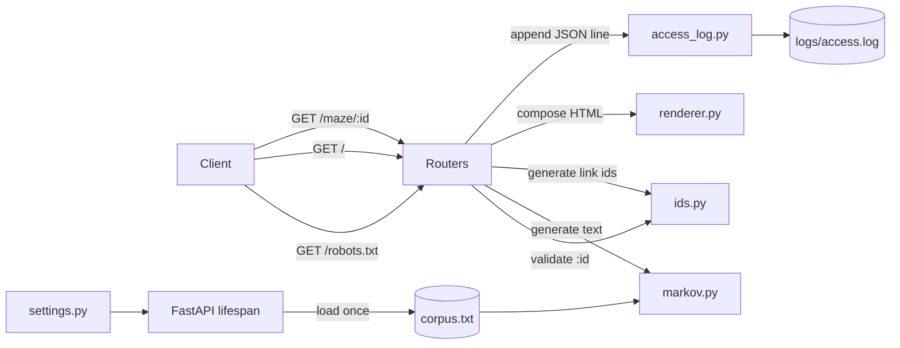
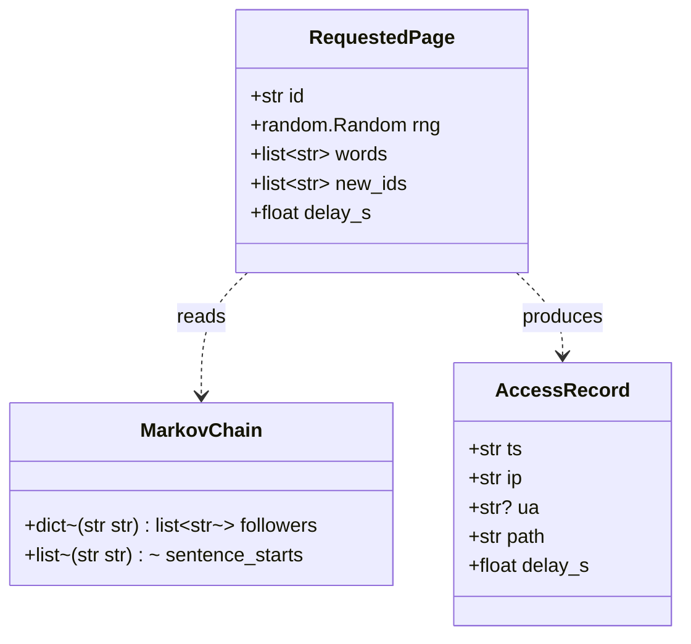
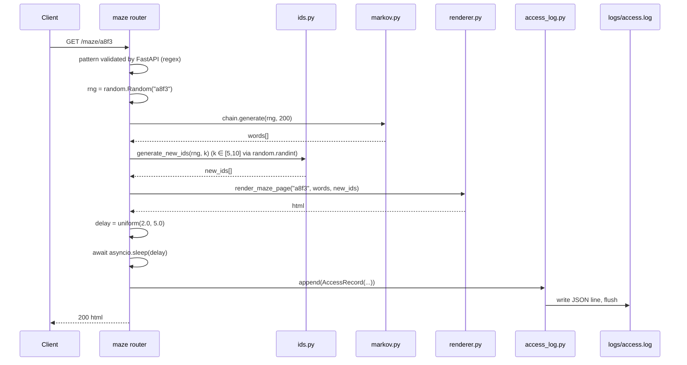
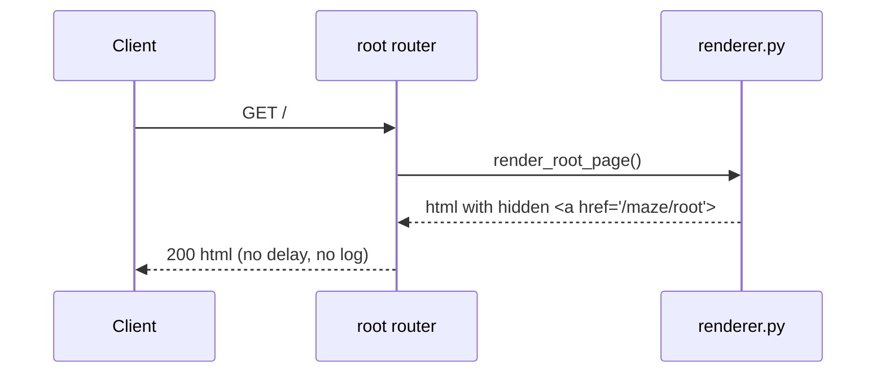

# Tar Pit v1 — Design

**Status:** Draft · **Date:** 2026-10-21 · **Requirements:** [requirements.md](./requirements.md)

## 1. Architecture overview

- Single-process FastAPI service, async throughout. No DB, no queue, no external services.
- Three HTTP routes (`/robots.txt`, `/`, `/maze/{id}`) sit on top of four internal modules: `markov` (text generation), `ids` (seed-driven link ID generation + input validation), `renderer` (pure HTML composition with escaping), `access_log` (JSON-lines appender).
- One `random.Random({id})` instance is constructed per `/maze/{id}` request and threaded through every seeded operation (Markov walk, outgoing-link ID selection). The module-level `random` is used only for the non-deterministic 2–5s delay.
- Shared state (Markov chain, access-log writer, settings) is built in a FastAPI `lifespan` and injected into handlers via `Depends(...)` — no module-level singletons.
- v1 runs under a **single uvicorn worker** to make the append-only log line-atomic without file locks.



## 2. Contracts (frozen)

Once approved, these shapes do not change without re-opening design.

### 2.1 HTTP endpoints

#### `GET /robots.txt`

| Field | Value |
|---|---|
| Status | `200 OK` |
| Content-Type | `text/plain; charset=utf-8` |
| Body (exact bytes) | `User-agent: *\nDisallow: /maze/\n` |
| Side effects | None. Not recorded in access log. |

#### `GET /`

| Field | Value |
|---|---|
| Status | `200 OK` |
| Content-Type | `text/html; charset=utf-8` |
| Body | HTML document containing: (a) a visible `<p>` with the human-reader copy, (b) exactly **one** `<a>` with inline `style="display:none"` and `href="/maze/{BAIT_ID}"`. |
| Side effects | None. Not recorded in access log. |

Human-reader copy (constant, verbatim):
> If you can read this, you're probably a human — or at least not a crappy bot.

Bait ID: constant `root` → `href="/maze/root"`. (`root` matches the `{id}` regex, so a client that follows it enters the maze normally.)

#### `GET /maze/{id}`

Path parameter `id`:
- **Pattern**: `^[A-Za-z0-9._~-]{1,64}$` (enforced by the route itself via FastAPI `Path(..., pattern=...)`).
- Values that do not match → **FastAPI returns 404 automatically**. No handler body runs. No log line written. (REQ-MAZE-07.)

Happy path (`id` matches pattern):

| Field | Value |
|---|---|
| Status | `200 OK` |
| Content-Type | `text/html; charset=utf-8` |
| Body | HTML with: (a) escaped Markov text of **200 words ±10%**, (b) **between 5 and 10** anchors with inline `style="display:none"` and `href="/maze/{new_id}"` where each `{new_id}` is a 4-char lowercase hex string. All text and all `{id}` reflections are HTML-escaped. |
| Timing | Delayed by a value sampled uniformly from `[delay_min_s, delay_max_s]` using `await asyncio.sleep(...)` before the response is returned. |
| Side effects | Exactly one JSON line appended to `logs/access.log` (schema in §2.4). |

Invalid-id path: FastAPI 404 as above; no delay, no log.

Error path (unexpected exception during generation):

| Field | Value |
|---|---|
| Status | `500 Internal Server Error` |
| Content-Type | `text/plain; charset=utf-8` |
| Body | Exactly: `internal error` |
| Side effects | Exception detail logged to stderr via `logging.getLogger("tarpit")`. **No** stack trace, no framework internals in the response body. **No** access log line (log is only written on 200). |

### 2.2 Internal module interfaces

Exact signatures. Implementors MAY add private helpers inside each module but MUST NOT change the public surface below.

#### `src/tarpit/ids.py`

```python
import random
import re
from typing import Final

ID_PATTERN: Final[re.Pattern[str]] = re.compile(r"^[A-Za-z0-9._~-]{1,64}$")
NEW_ID_PATTERN: Final[re.Pattern[str]] = re.compile(r"^[0-9a-f]{4}$")
BAIT_ID: Final[str] = "root"

def generate_new_ids(rng: random.Random, count: int) -> list[str]:
    """Return `count` 4-char lowercase hex strings drawn from `rng`.

    Deterministic for a given rng state. May include duplicates (callers
    that need uniqueness within the output must dedupe)."""

def is_valid_id(id_: str) -> bool:
    """True iff id_ matches ID_PATTERN."""
```

Guarantee: `generate_new_ids(random.Random("x"), 10)` returns the same list on every call (determinism).

#### `src/tarpit/markov.py`

```python
import random
from collections.abc import Mapping, Sequence

class MarkovChain:
    """Order-2 Markov chain. Immutable after construction."""

    @classmethod
    def from_corpus_text(cls, text: str) -> "MarkovChain":
        """Tokenise `text` into words, build (w1, w2) -> [next_word] table."""

    def generate(self, rng: random.Random, word_count: int) -> list[str]:
        """Produce `word_count` words.

        Starting pair is chosen via `rng.choice` from the set of pairs that
        begin a sentence (i.e. the word after a '.', '!' or '?' token).
        Each subsequent word is `rng.choice(followers[(w1, w2)])`.
        If a pair has no followers mid-walk, re-draw a start pair."""
```

Guarantees:
- `MarkovChain.from_corpus_text(same_text).generate(random.Random(seed), n)` returns the same list for identical `(text, seed, n)`.
- `generate` never raises on well-formed corpora with ≥ 2 words.

#### `src/tarpit/renderer.py`

```python
from collections.abc import Sequence

def render_robots_txt() -> str:
    """Return exactly `User-agent: *\nDisallow: /maze/\n`."""

def render_root_page() -> str:
    """Return the HTML for GET /. Includes the fixed human-copy <p> and
    one hidden anchor to /maze/{BAIT_ID}. HTML-escapes BAIT_ID."""

def render_maze_page(id_: str, words: Sequence[str], new_ids: Sequence[str]) -> str:
    """Return the HTML for GET /maze/{id}.

    - HTML-escapes `id_` and every element of `words` and `new_ids` before
      insertion.
    - Produces exactly one <p> containing `' '.join(words)`.
    - Produces one hidden <a style="display:none" href="/maze/{new_id}">
      per element in `new_ids`."""
```

All three functions are **pure**: no I/O, no clock, no randomness. Fully unit-testable.

#### `src/tarpit/access_log.py`

```python
import asyncio
from dataclasses import dataclass
from pathlib import Path
from typing import TextIO

@dataclass(frozen=True)
class AccessRecord:
    ts: str          # ISO-8601 UTC with trailing 'Z', e.g. "2026-10-21T10:40:12Z"
    ip: str          # dotted-quad or IPv6; "unknown" if neither header nor peer available
    ua: str | None   # value of User-Agent header, or None if absent
    path: str        # full request path, e.g. "/maze/a8f3"
    delay_s: float   # the applied delay, rounded to 2 d.p.

class AccessLogWriter:
    def __init__(self, file: TextIO, lock: asyncio.Lock) -> None: ...

    async def append(self, record: AccessRecord) -> None:
        """Serialise `record` to one JSON line (newline-terminated),
        write-and-flush under the lock. JSON key order: ts, ip, ua, path, delay_s.
        Blocking file I/O is run via asyncio.to_thread."""
```

Only fields in `AccessRecord` are ever written. REQ-LOG-03.

#### `src/tarpit/settings.py`

```python
from pathlib import Path
from pydantic_settings import BaseSettings, SettingsConfigDict

class Settings(BaseSettings):
    model_config = SettingsConfigDict(
        env_file=".env", env_prefix="TARPIT_", extra="ignore"
    )

    host: str = "127.0.0.1"
    port: int = 8000
    reload: bool = False
    log_level: str = "info"

    corpus_path: Path = Path("src/tarpit/corpus.txt")
    log_path: Path = Path("logs/access.log")

    delay_min_s: float = 2.0
    delay_max_s: float = 5.0

def get_settings() -> Settings: ...   # lru_cache'd
```

`reload` default is `False` (CLAUDE.md security guidance); dev opt-in via `.env`.

### 2.3 FastAPI dependency contract

Handlers receive these via `Depends`:

```python
def get_chain(request: Request) -> MarkovChain
def get_log_writer(request: Request) -> AccessLogWriter
def get_settings_dep() -> Settings
```

Each returns the lifespan-constructed singleton. Tests override these with FastAPI's `app.dependency_overrides`.

### 2.4 Access-log JSON schema

Exactly one line per logged request. Keys in this order:

```json
{"ts": "2026-10-21T10:40:12Z", "ip": "203.0.113.7", "ua": "SomeBot/1.0", "path": "/maze/a8f3", "delay_s": 3.4}
```

- `ts`: ISO-8601 UTC, second precision, `Z` suffix. Format: `strftime("%Y-%m-%dT%H:%M:%SZ")`.
- `ip`: `request.client.host` if present, else `"unknown"`. **No** `X-Forwarded-For` parsing in v1 (no reverse proxy per scope).
- `ua`: `request.headers.get("user-agent")` — may be `null` in JSON.
- `path`: `request.url.path` (never includes query string — queries aren't logged, REQ-LOG-03).
- `delay_s`: float, rounded to 2 d.p.

### 2.5 Module / repo layout

```
src/tarpit/
  __init__.py          # exports: app, main
  main.py              # create_app(), app, main(), lifespan
  settings.py          # Settings + get_settings
  dependencies.py      # Depends() providers
  markov.py            # MarkovChain
  ids.py               # ID_PATTERN, generate_new_ids, is_valid_id, BAIT_ID
  renderer.py          # render_* functions
  access_log.py        # AccessRecord, AccessLogWriter
  routers/
    __init__.py
    root.py            # GET /, GET /robots.txt
    maze.py            # GET /maze/{id}
  corpus.txt           # Moby-Dick plain text
tests/
  test_robots.py
  test_root.py
  test_maze.py
  test_markov.py
  test_ids.py
  test_renderer.py
  test_access_log.py
```

`crawlerblocker` package is deleted. `pyproject.toml` `[project.name]` and `[project.scripts]` entry renamed `tarpit`.

## 3. Data model

No persistent entities. All state is per-request and derived from `{id}`. A "page" is the ephemeral tuple below:



Lifecycle:
- `MarkovChain`: one per process; built once at startup; immutable; GC'd on shutdown.
- `AccessLogWriter`: one per process; owns an open file handle; closed on shutdown.
- `RequestedPage`: per-request; discarded after response.
- `AccessRecord`: per-request on happy path only; written and discarded.

## 4. Key flows

### 4.1 `GET /maze/{id}` — happy path



Note: the count `k` of outgoing links is drawn from `rng` (so repeated requests see the same `k`), satisfying REQ-MAZE-04 ("link targets are stable across repeat fetches").

### 4.2 `GET /maze/{id}` — invalid id

```mermaid
sequenceDiagram
  participant C as Client
  participant F as FastAPI
  C->>F: GET /maze/<bad>
  F-->>C: 404 Not Found
  Note over F: route pattern unmatched; handler never runs; no delay; no log line.
```

### 4.3 `GET /` — bait



## 5. Decisions

- **Delay randomness is NOT seeded** (uses module `random` / `random.uniform`). *Alternatives:* seed from `{id}` so delays are reproducible. *Why:* NFR "Determinism" scopes repeatability to response **bodies**; timing is explicitly orthogonal. Non-deterministic delay also makes passive timing-fingerprint attacks against the trap slightly harder.

- **Outgoing-link count `k` IS seeded** (drawn from the per-request `rng`). *Alternatives:* fix `k = 7`, or draw from module `random`. *Why:* REQ-MAZE-04 says link targets are stable across repeat fetches; a varying `k` would break byte-identity across refetches. Fixed `k` was rejected only because the spec says "5–10" (a range) — a seeded random `k` respects both constraints.

- **HTML is composed with `html.escape` + f-strings, not Jinja2.** *Alternatives:* Jinja2 templates. *Why:* two pages, one of them 95% generated text. Jinja adds a dep and templates without buying anything. Escape rule is one function call per inserted value.

- **Access log uses a plain `TextIO` + `asyncio.Lock` + `asyncio.to_thread`, not Python `logging` and not `aiofiles`.** *Alternatives:* stdlib `logging` with a JSON formatter; `aiofiles` package. *Why:* stdlib `logging` adds a format layer we don't need and makes "only these fields, in this order" harder to guarantee; `aiofiles` is a new dep. The thread-pool wrapper on a flushed append is fine for the v1 single-worker local use case.

- **Single uvicorn worker in v1.** *Alternatives:* multi-worker from the start. *Why:* multi-worker needs real file locking or per-worker log files, both of which are v2 problems per scope. Document in `README.md` so no one accidentally raises `--workers`.

- **Pattern validation happens at the route via `Path(..., pattern=...)`, not inside the handler.** *Alternatives:* handler-side validation returning 404 manually. *Why:* FastAPI's path-param regex yields a free 404 and keeps the handler free of control flow for the invalid case. Matches REQ-MAZE-07 exactly (no handler body, no log line).

- **Lifespan over `@app.on_event`.** *Alternatives:* deprecated `on_event`. *Why:* `lifespan` is the current FastAPI idiom and gives us an `AsyncExitStack`-shaped place to open and close the log file symmetrically.

- **No templates, no CSS files, no static dir.** *Alternatives:* a `static/` for a stylesheet. *Why:* `display:none` is inline on the one anchor that needs it. No other styling exists in v1.

- **Delay bounds live in `Settings` even though they're frozen constants in requirements.** *Alternatives:* module constants. *Why:* tests set `TARPIT_DELAY_MIN_S=0 TARPIT_DELAY_MAX_S=0` to run the whole suite in milliseconds. Prod defaults still enforce 2–5s.

## 6. Risks & edge cases

- **File I/O blocking the event loop.** Mitigated by `asyncio.to_thread(file.write + flush)`. If measured latency on `/` degrades under load, revisit with a background-queue writer.
- **Markov `(w1, w2)` with no followers mid-walk.** `MarkovChain.generate` must re-draw a sentence-start pair rather than raise. Covered by a unit test with a crafted tiny corpus.
- **Corpus file missing or empty at startup.** `lifespan` raises on failure; uvicorn exits with a non-zero code. Clearer error > lazy failure on first request.
- **Hashing of `{id}` across Python versions.** `random.Random(seed_string)` is version-stable in Python ≥ 3.11; project pins 3.13 (`requires-python = ">=3.13"`). Guarantee holds.
- **Timing attacks / fingerprinting the trap.** Deliberately not addressed in v1 (bot-detection is scope-out). Non-seeded delay is a minor hedge.
- **XSS via `{id}` in reflected anchors.** Every insertion into HTML goes through `html.escape(..., quote=True)` in `renderer.py`. Tested with an `{id}` containing `<script>` — the regex excludes it from valid input, so this is defence-in-depth.
- **Multiple workers would race on the log.** Enforced at the ops level: README documents "run with the default `--workers 1`". A `settings.workers` field is NOT added — raising workers must be a conscious edit elsewhere.
- **Log file growth.** Append-only forever. For v1 local-only runs this is fine; a cron rotation or v2 feature covers it later.
- **Clock skew / timezone.** `ts` is always UTC via `datetime.now(UTC).strftime(...)`. Never uses local time.

## 7. Out of scope for this design

- Everything in `requirements.md §5` under "v1 is local-only" (bot detection, fingerprinting, rate limiting, reverse proxy, public deployment).
- Log rotation and multi-worker log coordination — deferred to v2.
- A corpus-selection mechanism — Moby-Dick is hard-coded via `settings.corpus_path`'s default.
- Any UI, admin page, or non-HTTP interface.
- Any analytics or log-analysis tooling.
